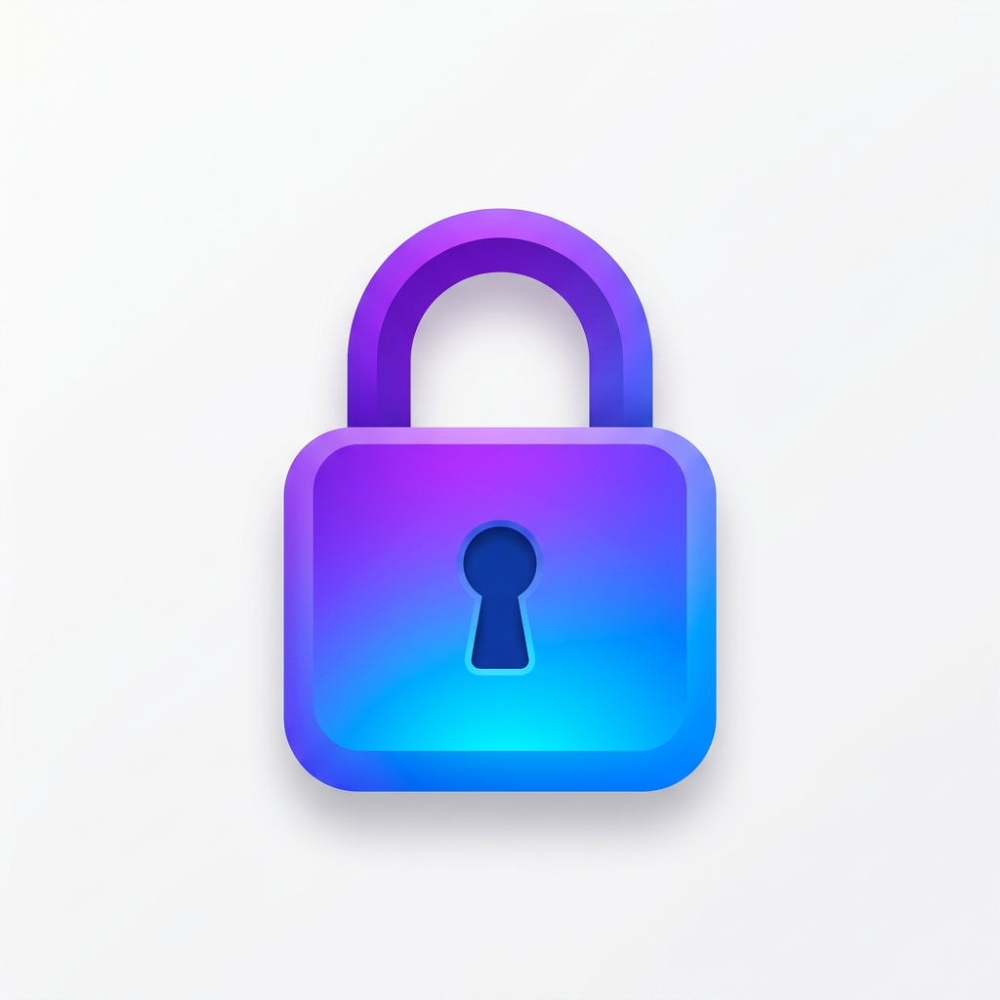

<p align="center">
  
</p>

<h1 align="center">LocKey</h1>
<p align="center">
  <strong>Il Password Manager 100% Offline, Gratuito e a Conoscenza Zero (Zero-Knowledge)</strong><br>
  Ideato, sviluppato e distribuito da <strong><a href="https://www.biragodev.it">BiragoDev</a></strong>
</p>

<p align="center">
  
  
  
  
</p>

---

## 🔒 Perché LocKey? La Filosofia "Zero-Network"

La maggior parte dei gestori di password moderni impone la sincronizzazione su server cloud remoti, esponendo i tuoi dati più intimi a violazioni informatiche (data breach), interruzioni di servizio e abbonamenti mensili ricorrenti.

**LocKey nasce con una filosofia radicale opposta: la sovranità totale dei tuoi dati.**

- 🚫 **Zero Connessioni di Rete**: Le tue password non lasciano mai il tuo dispositivo. Nessuna richiesta verso server esterni, nessun account cloud obbligatorio.
- 🛡️ **Zero Telemetria & Zero Pubblicità**: Nessun tracciamento, nessun SDK pubblicitario di terze parti, rispetto assoluto della tua privacy (GDPR compliant).
- ⚡ **Applicazioni Native e Standalone**: Sviluppate per sfruttare al meglio l'hardware del tuo Mac (SwiftUI + Secure Enclave) e del tuo PC Windows (Electron + crittografia locale).
- 🆓 **Gratuito per Sempre**: Distribuito a titolo completamente gratuito da **BiragoDev** ([www.biragodev.it](https://www.biragodev.it)).

---

## 🚀 Versioni Disponibili

### 🍏 macOS (SwiftUI Nativo)
Sviluppato interamente in Swift 5 per offrire prestazioni istantanee ed integrazione profonda con l'ecosistema Apple:
* **Sblocco con Touch ID / Face ID**: La chiave master è custodita nell'**Apple Keychain** protetto a livello hardware dal coprocessore **Secure Enclave**.
* **Quick Access nella Menu Bar (Menulet)**: Icona rapida nella barra dei menu per cercare e copiare le credenziali al volo.
* **Scorciatoia Globale**: Premi `Option + L` da qualsiasi schermata per mostrare o nascondere l'app istantaneamente.
* **Clipboard Auto-Clear**: Pulizia automatica degli appunti di sistema dopo 30 secondi per impedire letture indebite.

### 💻 Windows (Desktop Standalone)
Applicazione desktop offline per Windows 10 e 11:
* **Storage Locale Sicuro**: Il database crittografato risiede unicamente in `%APPDATA%/LocKey/vault.json`.
* **Blocco Automatico Istantaneo (Focus Loss)**: Se riduci l'app a icona o cambi finestra, il vault si blocca immediatamente rimuovendo le chiavi dalla memoria RAM.
* **Suite di Diagnostica di Sicurezza**: Audit in locale per scovare password deboli o duplicate e verifica breach tramite protocollo k-Anonymity (SHA-1 prefix).
* **Pulizia della Clipboard**: Cancellazione automatica della password dagli appunti di Windows a 30s.

---

## 🛡️ Architettura di Sicurezza

Tutte le operazioni crittografiche avvengono sul dispositivo locale prima di toccare qualsiasi supporto di memoria:

```
[Master Password] + [Salt Casuale]
          │
          ▼
   PBKDF2 (SHA-256, 100.000 iterazioni)
          │
          ▼
   [Chiave a 256-bit]
          │
          ▼
  Crittografia AES-256-GCM ──▶ [Vault Locale Cifrato (.json)]
```

* **Zero-Knowledge**: La tua Master Password non viene mai salvata sul disco in chiaro. Sei l'unico custode del tuo Vault.
* **Backup Interoperabili (.lockey)**: Esporta ed importa il tuo archivio protetto tra Mac e Windows con compatibilità al 100%.

---

## 📥 Download

Scarica l'ultima versione stabile dalla sezione **[Releases](https://github.com/biragodevelopers-lgtm/LocKey/releases)** o direttamente dal sito ufficiale:

| Sistema Operativo | Formato | Download |
| :--- | :--- | :--- |
| **macOS** *(Apple Silicon & Intel)* | `.dmg` Installer | [Scarica per Mac](https://github.com/biragodevelopers-lgtm/LocKey/releases/latest) |
| **Windows** *(10 / 11 a 64-bit)* | `.exe` Setup NSIS | [Scarica per Windows](https://github.com/biragodevelopers-lgtm/LocKey/releases/latest) |

---

## ⚖️ Licenza e Termini Legali

LocKey è distribuito come software gratuito (**Freeware**) "COSÌ COM'È" (*AS-IS*) senza scopo di lucro.  
Consulta il documento completo dei [Termini e Condizioni d'Uso e Privacy Zero-Data](TERMINI_E_PRIVACY.md).

---

## 👨‍💻 Sviluppatore

Ideato, progettato e sviluppato con passione da **BiragoDev**:  
🌐 Sito Web: [www.biragodev.it](https://www.biragodev.it)  
📧 Contatti: [info@biragodev.it](mailto:info@biragodev.it)
